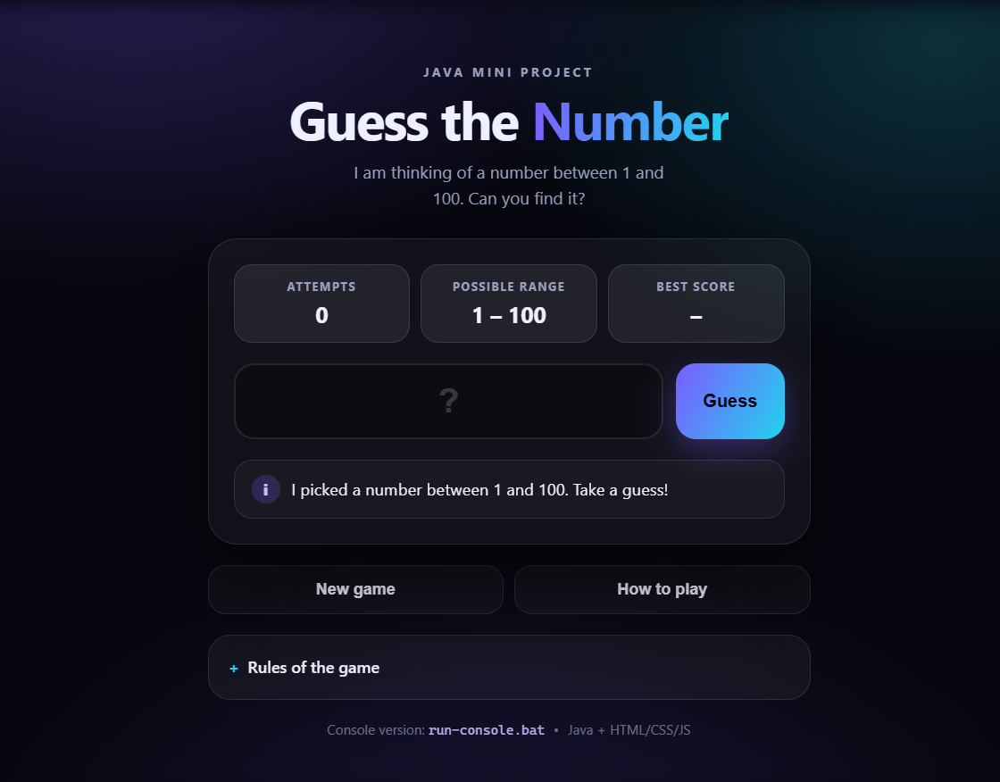

# Guess the Number - Java Mini Project

An interactive number guessing game with **two front ends**:

- a **website** (`web/`) served by a small Java web server, and
- the original **console** version (`src/guessnumber/Main.java`).

The computer picks a secret number between **1 and 100**. The player guesses,
the program replies "too small" or "too large", and every valid attempt is
counted. Once the number is found the player can start another round. Invalid
input (letters, empty lines, numbers outside 1-100) is rejected and **does not
count** as an attempt.

The project uses **only the JDK** - no external libraries, no database, no
build tool to install.

**Live demo:** <https://atif-2602.github.io/guess-the-number/>



---

## 1. Requirements

- JDK 17 or newer (`javac -version` should work)
- Any modern browser (Chrome, Edge, Firefox)

## 2. Play it online

The website is already deployed on GitHub Pages:

**<https://atif-2602.github.io/guess-the-number/>**

GitHub Pages can only host static files, so the page automatically runs the
browser version of the game there. No installation needed.

## 3. Run the website locally

Double-click **`run.bat`**.

It compiles the sources and starts the server on <http://localhost:8080>.
The browser opens automatically. Press `Ctrl+C` in the terminal to stop it.

To use another port:

```bat
run.bat 9090
```

## 4. Run the console version

Double-click **`run-console.bat`**, or:

```bat
build.bat
java -cp out guessnumber.Main
```

## 5. Run the automated tests

```bat
test.bat
```

The script starts the server on port 8099, checks the pages and the JSON API
(including input validation, unknown sessions and a full solved round), then
shuts the server down again.

---

## 6. Features

**Game rules**

- Random secret number in the range 1-100, generated on the server
- "Too small" / "too large" hints after every valid guess
- Attempt counter that ignores invalid entries
- Play again without restarting the program
- Best score for the session (console) or stored in the browser (website)

**Input validation**

- Letters, symbols and empty input are rejected
- Numbers below 1 or above 100 are rejected
- Rejected input never increases the attempt counter
- The page keeps the number field numeric only

**Website extras**

- Glass-style responsive UI with a live "possible range" that narrows after
  every hint
- Colour-coded guess history
- Confetti animation and a rating for the win
- Best score saved in `localStorage`
- The secret number never leaves the Java process, so it cannot be read from
  the browser's developer tools

---

## 7. Project structure

```
JAVA_MINIPROJECT/
|-- build.bat                  compile every .java file into out/
|-- run.bat                    build + start the web server
|-- run-console.bat            build + play in the terminal
|-- test.bat                   run the automated API/UI tests
|-- deploy.bat                 publish web/ to the gh-pages branch
|
|-- src/guessnumber/
|   |-- Main.java              console program (menu, rounds, summary)
|   |-- Game.java              game rules: secret number, hints, attempts
|   |-- GameSession.java       one web round with a unique id
|   |-- GuessResult.java       enum: TOO_LOW, TOO_HIGH, CORRECT
|   |-- InputHandler.java      validated console input
|   `-- web/WebServer.java     HTTP server, static files + JSON API
|
|-- web/
|   |-- index.html             game page
|   |-- styles.css             styling and animations
|   `-- app.js                 browser logic + offline game engine
|
|-- tests/api-test.ps1         automated end-to-end test
|-- tools/deploy-pages.ps1     copies web/ into the gh-pages branch
`-- docs/screenshot.png        screenshot of the website
```

---

## 8. How the website works

```
Browser (HTML/CSS/JS)  --- POST /api/new-game --->  Java WebServer
                       <--- { gameId, min, max } ---

Browser (HTML/CSS/JS)  --- POST /api/guess ------>  Java WebServer -> Game
                       <--- { status, message, ---
                              attempts, finished }
```

| Method | Path            | Purpose                                   |
|--------|-----------------|-------------------------------------------|
| POST   | `/api/new-game` | Start a round, returns a `gameId`         |
| POST   | `/api/guess`    | Send `{ "gameId": "...", "guess": 42 }`   |
| GET    | `/`             | Serve `web/index.html` and the other files|

Example round with `curl`:

```bat
curl -X POST http://localhost:8080/api/new-game
curl -X POST http://localhost:8080/api/guess -H "Content-Type: application/json" -d "{\"gameId\":\"PASTE-ID\",\"guess\":50}"
```

Status codes: `200` ok, `400` invalid guess, `404` unknown game,
`409` round already finished.

---

## 9. Java concepts used

- Classes, objects and encapsulation (`Game`, `GameSession`)
- `enum` for the three possible hints (`GuessResult`)
- `java.util.Random` for random number generation
- Loops: `while` for the guessing loop, `for` for input checks
- Conditional statements and `switch` expressions
- Methods, parameters and return values; static vs instance members
- Exception handling: `NumberFormatException`, `NoSuchElementException`,
  custom `GameExitException`
- Collections: `ArrayList`, `ConcurrentHashMap`
- File I/O and `java.nio.file` for serving the web pages
- Networking: `com.sun.net.httpserver.HttpServer` and JSON requests/responses
- `StringBuilder`, `String.format`-style building and text escaping

## 10. Possible future improvements

- Difficulty levels (1-50 / 1-100 / 1-1000) and a countdown timer
- Multiplayer "closest guess wins" mode using WebSockets
- Store scores in SQLite or MySQL and show a leaderboard
- Sound effects and a light/dark theme switch
- Deploy the same Java server to a hosting service so friends can play

## 11. Deploying the website (GitHub Pages)

The site is live at:

**<https://atif-2602.github.io/guess-the-number/>**

It is published from the **`gh-pages` branch**, which contains only the
contents of the `web` folder. The repository's Pages setting is:

**Settings -> Pages -> Build and deployment -> Deploy from a branch ->
`gh-pages` / (root)**

To publish an updated website, run:

```bat
deploy.bat
```

The script copies the current `web` folder into the `gh-pages` branch and
pushes it; GitHub Pages refreshes the live site in about a minute. You can
also pass a commit message: `deploy.bat "new features"`.

GitHub Pages can only serve static files, so there the page automatically
switches to the built-in browser version of the game (`app.js`, `local` mode).
The rules, hints, attempt counting and best score are identical; only the
secret number is created by JavaScript instead of Java. When you open the site
through `run.bat`, the Java server is used instead.
